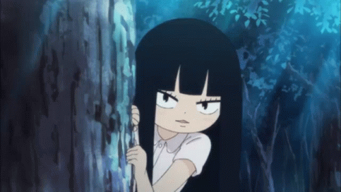

  <!-- Header Banner -->
  

   

  <!-- Visual Accent Sawako -->
  

    

  <!-- Status Badges -->
  

    
    
  

 

## 🌙 About Me

Hi, I'm Sha — an Information Systems student who enjoys designing, building, and figuring things out along the way.  
I'm currently exploring UI/UX, web development, and data, while slowly learning new technologies and turning ideas into small projects.  

- 🌱 **Currently learning:** Laravel · JavaScript · Data Analytics  
- 🎨 **Interested in:** UI/UX · Digital Products · Web Development  
- 🎐 Learning at my own pace, one project at a time.

 

> • 💻 **Focus:** Web Development / Data Analyst  
> • 🌌 **Atmosphere:** Midnight Blue & Clean Code  
> • 🌸 **Aesthetic:** Sawako Kuronuma Theme  
> • 📫 **Contact:** arshakhoirunnisa@gmail.com  

---

## 🛠️ Tools & Technologies

### 🎨 Design & Documentation

  
  
  

### 💻 Development

  
  
  
  
  
  

### 🔧 Development Tools

  
  
  
  

### ☁️ Deployment & Platforms

  
  
  

---

## 📂 Featured Projects
- **[Portfolio Web](https://github.com/arshakhoirunnisa-art)**: Website portofolio pribadi bertema *midnight & aesthetic*.
- **[Project Lainnya](https://github.com/arshakhoirunnisa-art)**: Kumpulan tugas dan latihan koding interaktif.

---

## 📊 GitHub Stats

  
  

---

## 🎧 Currently Listening

## 🎧 Currently Listening

  

 

  
<em>"Still learning, still building, one project at a time."</em>

 

  

